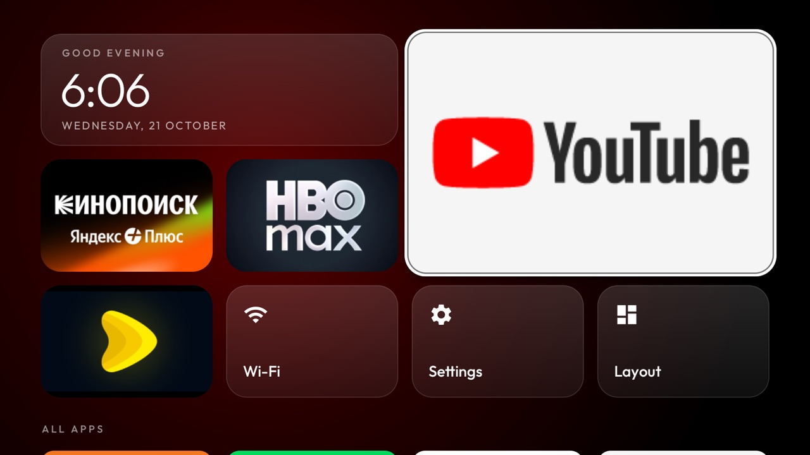
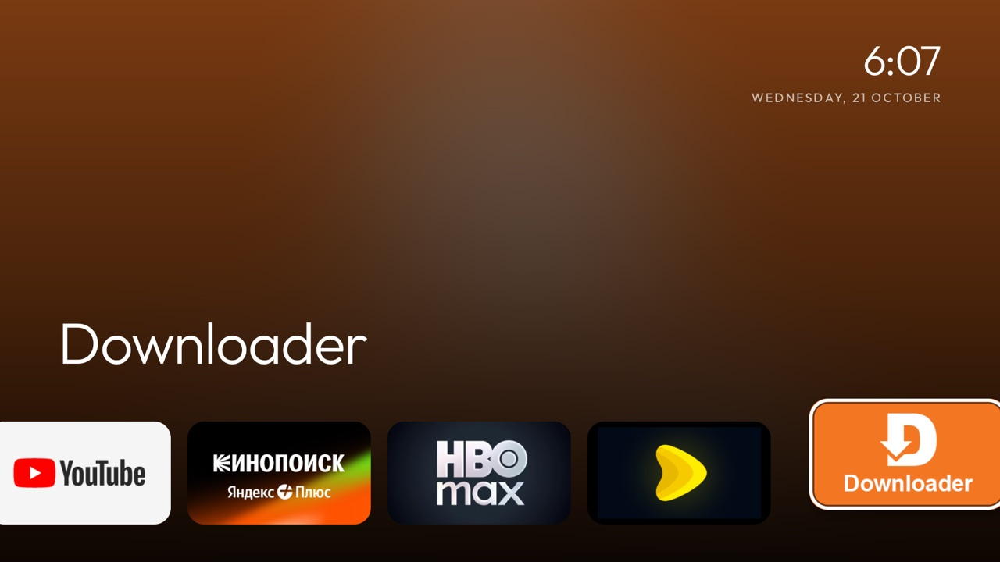
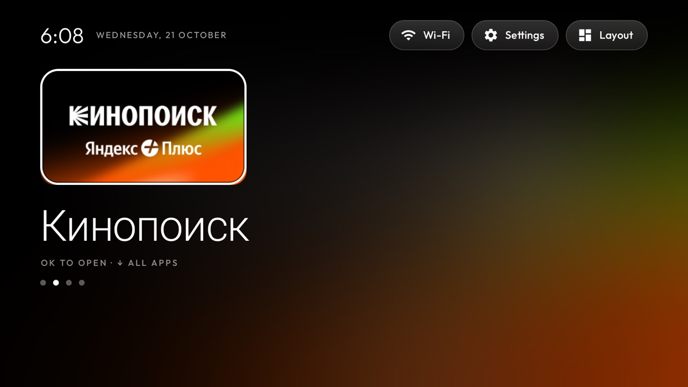
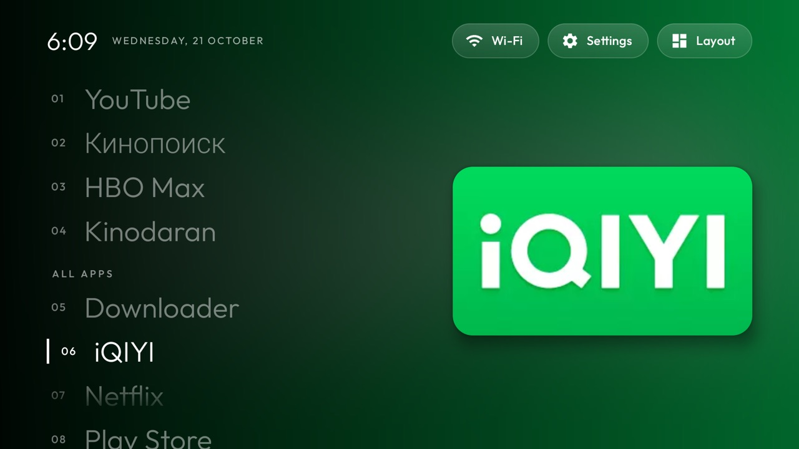
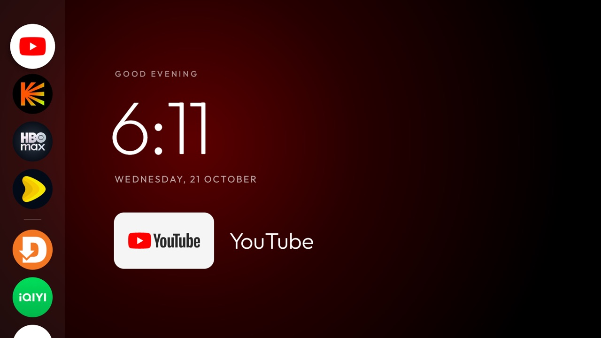
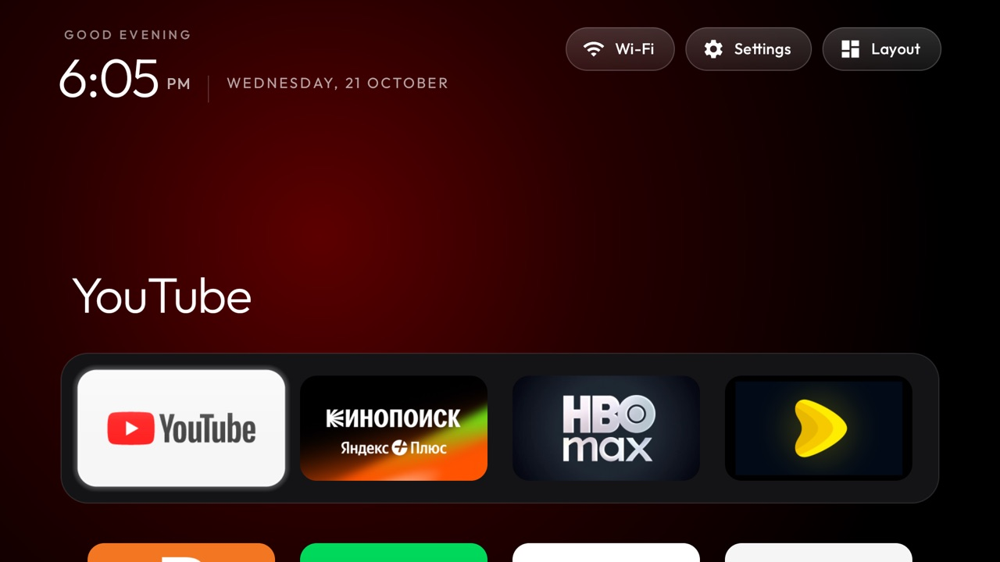
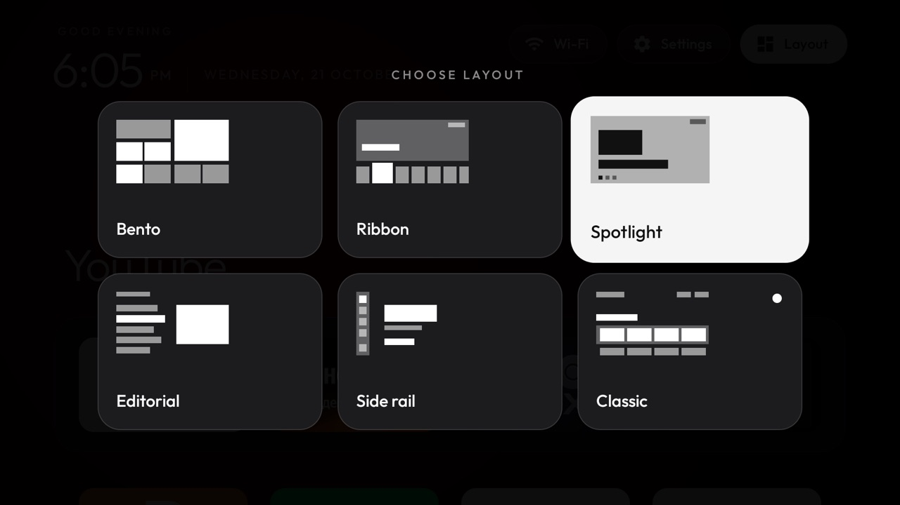

# BoxClean

[](https://github.com/VachaganGrigoryan/BoxClean/actions/workflows/ci.yml)
[](https://github.com/VachaganGrigoryan/BoxClean/releases/latest)
[](LICENSE)

**Make a Xiaomi Mi Box S 2nd gen quiet, fast and yours.** BoxClean strips the ads, telemetry and
auto-installs from Google TV over network ADB. It then replaces the stock home screen with a small offline
launcher that has six layouts to choose from.

🌐 **[boxclean.vachagan.dev](https://boxclean.vachagan.dev)**

<p align="center">
  
</p>

## What it is
BoxClean has two parts:

- **`tools/boxclean.py`**: debloats the box over network ADB, and every change can be undone. Packages are
  **disabled** for user 0 (`pm disable-user`), never uninstalled. Before the first change, the tool records
  each package's state and the current Home app, so `restore` puts everything back. `disable` and `restore`
  both take `--dry-run`.
- **BoxClean Home** (`launcher/`): a home screen with no network access, no AndroidX, no accounts and no
  trackers.
  - Six layouts, switched from the remote.
  - Remote buttons that open your own apps.
  - A drifting clock screensaver.
  - Plain framework views, so it stays fast on the box's small GPU.

It was built and tested on a **Xiaomi Mi Box S 2nd gen (MiTV-AFKR0 "jaws", Google TV 11)**. Other Android TV
boxes may work with their own package lists.

## Screenshots
| | |
|---|---|
|  **Bento**: the default. A board of rounded cells with a clock, four big apps and Wi-Fi, Settings and Layout; every other app is in a grid below. |  **Ribbon**: LG webOS style. The focused app's banner, blurred, fills the screen above one ribbon of cards. |
|  **Spotlight**: one app at a time, big. Left/right flips through the apps, Down opens a strip of all of them. |  **Editorial**: a magazine contents page, with numbered app names and the focused one's banner framed beside them. |
|  **Side rail**: round app icons down the left edge next to a big clock. |  **Classic**: Apple TV style, with a large app name over a dock, a gliding glass highlight and a grid. |

<p align="center">
  <br>
  <sub>The <b>Layout</b> button on every home screen opens this picker.</sub>
</p>

## Inspired by
BoxClean is our own rebuild of the idea behind **[CleanYourTV](https://github.com/Gathin23/cleanyourtv)**
by Gathin. The Classic layout's look and motion are adapted from CleanYourTV's launcher: the Outfit type, the
colour glow sampled from the focused app, the glass highlight, the clock screensaver and the remote-key
service. The first debloat list started from its Mi Box S 2nd gen example. Those parts are MIT-licensed; see
[`NOTICE`](NOTICE). The Outfit font is under the SIL Open Font License
([`launcher/FONT-LICENSE-OFL.txt`](launcher/FONT-LICENSE-OFL.txt)).

## Requirements
- macOS or Linux, on the same network as the box.
- [`uv`](https://docs.astral.sh/uv/) (it brings its own Python).
- Android platform-tools (`adb`), on your `PATH` or at `~/Library/Android/sdk/platform-tools/adb`.
- JDK 17 or newer, to build the launcher. The Gradle wrapper is included.

## Installation
Pass the box's IP as `TV_HOST` to every command. The examples use `TV_HOST=<ip>`.

### 1. Turn on ADB on the box
Settings → System → About → press OK on **Build** 7 times. Then Developer options → **USB debugging ON**.
Note the IP address (Settings → Network). Accept "Allow debugging?" when it appears on the TV.

### 2. Look first, and back up
Neither command changes anything:
```sh
TV_HOST=<ip> uv run tools/boxclean.py probe    # model, Android version, ADB state, current Home app
TV_HOST=<ip> uv run tools/boxclean.py backup   # packages, props and settings → backups/<time>/
```

### 3. Debloat in batches
Dry-run each list first, then apply it, and take a screenshot in between to check that the TV still behaves:
```sh
TV_HOST=<ip> uv run tools/boxclean.py disable lists/1-telemetry-ads.txt --dry-run
TV_HOST=<ip> uv run tools/boxclean.py disable lists/1-telemetry-ads.txt
TV_HOST=<ip> uv run tools/boxclean.py shot shots/01.png
```
| List | What it turns off |
|---|---|
| `lists/1-telemetry-ads.txt` | Telemetry, ads, promos and auto-installs |
| `lists/2-personal.txt` | Extras the owner doesn't use: Assistant/voice search, Chromecast built-in, the phone remote, and more. Edit it to suit you. |
| `lists/3-launcher.txt` | The stock Google TV launcher and setup wizard. **Run this only after step 4.** |

`com.netflix.ninja` was turned back on by hand after the batches, for the remote's Netflix button.

### 4. Install BoxClean Home
Build and install from source:
```sh
TV_HOST=<ip> launcher/build-install.sh
TV_HOST=<ip> uv run tools/boxclean.py disable lists/3-launcher.txt
```
The script builds the launcher, installs it, makes it Home and turns on its remote-button service.

To skip the build, download `boxclean-home-<version>.apk` from [Releases](https://github.com/VachaganGrigoryan/BoxClean/releases/latest) and run
`adb install boxclean-home-<version>.apk`, then
`adb shell cmd package set-home-activity com.boxclean.home/.MainActivity`. The release APK is signed with a
debug key: to switch to a copy you built yourself, uninstall the release first. The remote buttons need
`KeyService` turned on, which `build-install.sh` does for you. If the
tool skips `setupwraith` because the setup wizard owns your Wi-Fi network, forget the network in Settings,
join it again, and run the command again.

### 5. Pick a layout and the screensaver
Press **Layout** on the home screen and choose one. The choice survives reboots. For the clock screensaver:
```sh
adb shell settings put secure screensaver_components com.boxclean.home/.ClockDream
```

### 6. Close ADB again
Developer options → USB debugging **OFF** → "Revoke USB debugging authorisations" → reboot. Then check:
```sh
TV_HOST=<ip> uv run tools/boxclean.py closed   # must say "refused"
```

## Using it
- **Layouts:** every home screen has a **Layout** button that opens the picker. OK switches, Back closes it.
  - **Bento:** the D-pad moves cell to cell, and Down from the bottom row goes into the app grid.
  - **Ribbon:** left and right move along the ribbon; the Wi-Fi, Settings and Layout cards are at its end.
  - **Spotlight:** left and right flip through the four dock apps and OK opens one. Down opens the strip of
    all apps, and Up closes it. Up from the stage goes to the pills.
  - **Editorial:** up and down move through the list, and Up from the top goes to the pills.
  - **Side rail:** up and down move along the rail; Wi-Fi, Settings and Layout are at its foot.
  - **Classic:** the dock on top, the grid below, and the pills above the dock.
- **Back** always returns to the first app. **Home** starts over.
- **Remote buttons:** **Apps** opens the "all apps" part of the current layout. Buttons whose own app is
  disabled can open an app of your choice (see below).

## Customize
Edit [`launcher/app/src/main/res/values/config.xml`](launcher/app/src/main/res/values/config.xml), then run
`launcher/build-install.sh`:
- `dock_packages`: the four featured apps, in order: Bento's big cells, the dock, and Spotlight's pages.
- `app_keys`: remote buttons whose own app is off, written as `KEYCODE_BUTTON_7:ru.kinopoisk.tv`. On this
  remote, Prime Video = `BUTTON_7` and Xiaomi TV+ = `BUTTON_5`. YouTube and Netflix stay with Xiaomi's own
  handler (`partnercustomizer`).

The buttons go through `KeyService`, an accessibility service that only filters keys and never sees the
screen. `build-install.sh` re-enables it after every install, because a reinstall unbinds it. To check it:
`adb shell dumpsys accessibility | grep -A3 'Bound services'`.

## Undo
`TV_HOST=<ip> uv run tools/boxclean.py restore lists/<list>.txt` re-enables what that list disabled, using
the `<list>.record.json` written before the first change, and gives Home back to its old owner.
- Run `restore lists/3-launcher.txt` before a factory reset.
- After `restore lists/2-personal.txt`, put the Google screensaver back by hand, since restore doesn't
  touch settings:
  `adb shell settings put secure screensaver_components com.google.android.apps.tv.dreamx/.service.Backdrop`.

## Development
```
tools/boxclean.py        the debloat CLI (probe, backup, disable, restore, shot, closed)
lists/                   package lists, one batch per file
tests/                   pytest for the CLI
launcher/                BoxClean Home (Android, Java, no AndroidX)
  app/src/main/java/com/boxclean/home/
    MainActivity         Home activity: builds the chosen layout and forwards its lifecycle
    Layouts, LayoutPicker  the layout registry and the picker panel
    BaseHome             what every layout shares: app lists, cards, glow, focus lift, utility buttons
    BentoHome … ClassicHome  one class per layout, each with its own res/layout/activity_*.xml
docs/media/              README screenshots and demo
```
To add a layout:
1. Write a `BaseHome` subclass and its layout XML.
2. Register it in `Layouts` (id, name and preview drawable) and in `MainActivity`'s `switch`.

Checks:
```sh
uv run ruff check . && uv run ruff format --check . && uv run pytest -q
cd launcher && ./gradlew testReleaseUnitTest lintRelease assembleRelease
```

## License
BoxClean is licensed under the [Apache License 2.0](LICENSE). The parts adapted from CleanYourTV stay under
their MIT license, and the Outfit font under the SIL Open Font License; see [`NOTICE`](NOTICE).
